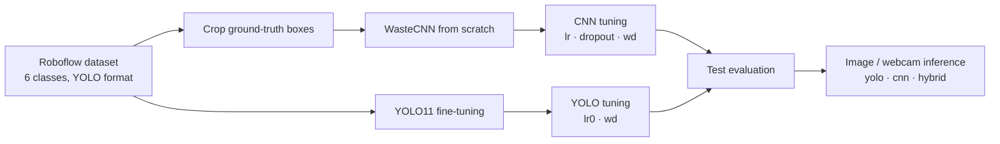

# ♻️ Smart Waste Detection — CNN vs YOLO11

Detecting and classifying six types of household waste (garbage bags, glass, paper bags,
PET bottles, plastic bags and cans) with two approaches trained on the same Roboflow dataset:

1. **WasteCNN** — a 423 k-parameter convolutional classifier built and trained **from scratch** on object crops.
2. **YOLO11** — a COCO-pretrained Ultralytics detector **fine-tuned** to locate *and* classify every item in a full image.

Both models go through hyperparameter tuning, are evaluated on a held-out test split, and can run
live on a webcam — including a **hybrid mode** where YOLO finds objects and the CNN re-classifies each crop.


<p align="center">
  
  <br><em>Tuned YOLO11n predictions on unseen test images.</em>
</p>

---

## 📊 Results at a glance

All numbers below are copied from the executed notebook outputs
([`notebooks/waste_detection.ipynb`](notebooks/waste_detection.ipynb)); the full breakdown is in
[`docs/RESULTS.md`](docs/RESULTS.md) and machine-readable copies are in [`results/metrics/`](results/metrics).

| Model | Evaluated on | Precision | Recall | F1 | mAP@50 | mAP@50-95 | Params |
|---|---|---:|---:|---:|---:|---:|---:|
| WasteCNN — baseline | 690 test crops | 0.732 | 0.725 | 0.724 | — | — | 0.42 M |
| **WasteCNN — tuned** (lr 1e-3, dropout 0.2, wd 1e-4) | 690 test crops | **0.82** | **0.82** | **0.82** | — | — | 0.42 M |
| YOLO11m — baseline (40 epochs) | 959 val images | 0.941 | 0.881 | 0.910 | 0.949 | 0.815 | 20.0 M |
| **YOLO11n — tuned** (lr0 3e-4, wd 5e-4, 25 epochs) | **477 test images** | **0.948** | **0.913** | **0.930** | **0.964** | **0.825** | 2.6 M |

CNN accuracy rose from **72.5 % → 81.9 %** with tuning. The tuned **YOLO11n beat the 8× larger YOLO11m**
baseline on validation mAP@50-95 (0.831 vs 0.815) while training in about a sixth of the time
(0.56 h vs 3.18 h on an RTX 5060 Laptop GPU) and running at 2.9 ms per image on the test set.

> **How to read the comparison.** The CNN classifies objects that have *already been cropped* from
> ground-truth boxes, so its scores measure classification only. YOLO has to find the objects and
> classify them, so its scores cover localisation too. mAP does not apply to the CNN.

<p align="center">
  
</p>

---

## 🧭 Pipeline

<p align="center">
  
</p>



Architecture details, layer tables and diagrams for both models: **[`docs/ARCHITECTURE.md`](docs/ARCHITECTURE.md)**.

---

## 📁 Repository structure

```
smart-waste-detection/
├── main.py                     # Single entry point: whole pipeline + CLI (converted from the notebook)
├── requirements.txt
├── .env.example                # ROBOFLOW_API_KEY template (copy to .env)
├── LICENSE
├── notebooks/
│   └── waste_detection.ipynb   # Original executed notebook (source of every reported number)
├── docs/
│   ├── ARCHITECTURE.md         # CNN + YOLO11 architecture, diagrams, flowcharts
│   ├── RESULTS.md              # Full results, per-class tables, tuning, discussion
│   ├── DATASET.md              # Dataset source, classes, splits, crop generation
│   ├── USAGE.md                # Installation and full CLI reference
│   ├── NOTEBOOK_TO_SCRIPT.md   # What changed from the notebook and why
│   └── diagrams/               # PNG diagrams used in the docs
├── results/
│   ├── figures/                # Training curves, confusion matrices, comparisons
│   ├── metrics/                # CSV / JSON results extracted from the notebook
│   └── predictions/            # Sample YOLO predictions on test images
├── scripts/
│   └── make_diagrams.py        # Regenerates docs/diagrams (Graphviz)
├── data/                       # Created at runtime (git-ignored) — see data/README.md
└── models/                     # Weights (git-ignored) — see models/README.md
```

---

## 🚀 Quick start

```bash
# 1. Clone and install
git clone https://github.com/tanjimsamad/smart-waste-detection.git
cd smart-waste-detection
python -m venv .venv && source .venv/bin/activate      # Windows: .venv\Scripts\activate
pip install -r requirements.txt                          # install the CUDA build of torch first for GPU

# 2. Add your Roboflow API key
cp .env.example .env                                     # then edit .env

# 3. Run everything (download → crops → CNN → YOLO → evaluation → comparison)
python main.py all
```

Or step by step:

```bash
python main.py download          # Roboflow dataset → data/waste_dataset
python main.py crops             # object crops → data/cnn_crops
python main.py tune-cnn          # 3 CNN configs, best → models/cnn_best_tuned.pt
python main.py eval-cnn
python main.py train-yolo        # YOLO11m baseline
python main.py tune-yolo         # 3 YOLO11n configs, best → models/yolo_best.pt
python main.py eval-yolo         # test split
python main.py compare

python main.py predict --source path/to/image_or_folder --mode yolo
python main.py webcam --mode hybrid     # YOLO boxes + CNN labels; press Q to quit
```

Every option is documented in [`docs/USAGE.md`](docs/USAGE.md). Outputs go to `outputs/`.

---

## 🔍 Key findings

- **Transfer learning dominates.** Pretrained YOLO11 reaches 0.93 F1 on full images; the from-scratch CNN
  reaches 0.82 on the easier crop-classification task.
- **Tuning mattered most for the CNN.** Lower dropout (0.2) and weight decay (1e-4) gave a 9.4-point accuracy
  gain. The winning run was still improving at the 50-epoch cap, so it is likely under-trained.
- **Smaller was better for YOLO here.** With a lower learning rate (3e-4), YOLO11n out-scored the YOLO11m
  baseline. The two runs also differ in epochs and weight decay, so this is not a controlled size comparison.
- **Hardest classes:** `Plastic_Bag` for the CNN (recall 0.67) and `Garbage_Bag` for YOLO (mAP@50-95 0.784) —
  both are deformable, textureless objects that look alike.

---

## ⚠️ Limitations

- The CNN was trained on tight ground-truth crops; in `--mode cnn` the webcam classifies the *whole frame*,
  which only works when one object fills the view. Use `--mode hybrid` for cluttered scenes.
- The CNN tuning grid had three configurations and YOLO tuning used only the nano model, so neither search is exhaustive.
- Results come from one seed (42) on one dataset; no cross-validation or confidence intervals.
- The dataset is balanced by design (equal objects per class); real waste streams are not.

## 🔮 Future work

Train the CNN longer and with a learning-rate schedule; try a pretrained backbone (ResNet/EfficientNet)
for a fairer classifier baseline; tune YOLO11s/m with the same budget; export to ONNX/TensorRT for an
edge device (Jetson / Raspberry Pi) driving a sorting bin.

---

## 🙏 Acknowledgements

- Dataset: [**Waste Detection v1**](https://universe.roboflow.com/object-detection-cfmul/waste-detection-0momv/dataset/1)
  by *object-detection-cfmul* on Roboflow Universe, licensed **CC BY 4.0**.
- [Ultralytics YOLO11](https://github.com/ultralytics/ultralytics) (AGPL-3.0) and [PyTorch](https://pytorch.org).

## 📜 License

Code is released under the [MIT License](LICENSE). The dataset and the Ultralytics library keep their own licenses.

## 👤 Author

**Tanjim Samad Swapnil** — BSc in Mechatronics Engineering, RUET, Bangladesh
GitHub: [@tanjimsamad](https://github.com/tanjimsamad)
