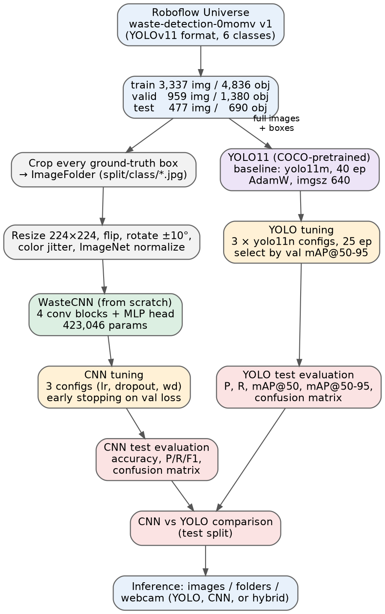
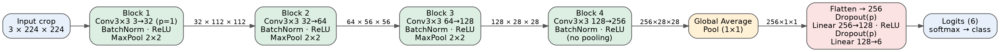
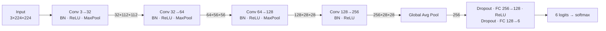
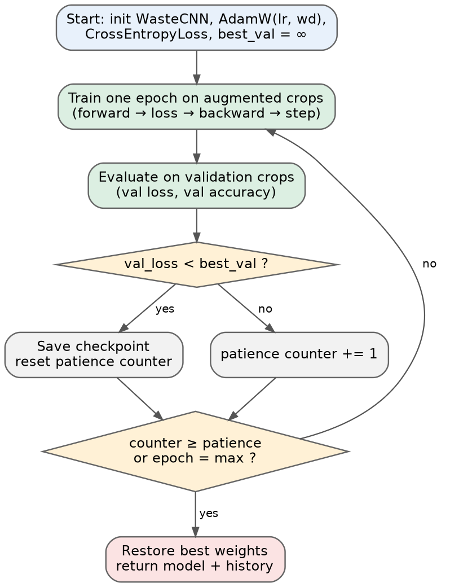
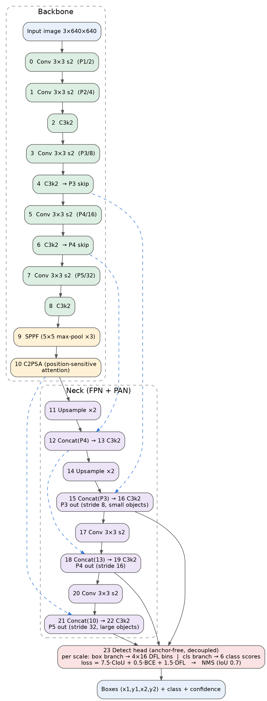
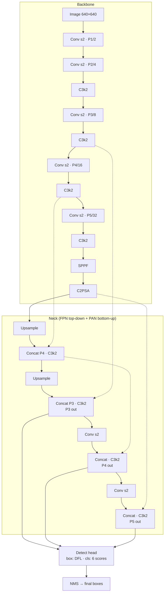
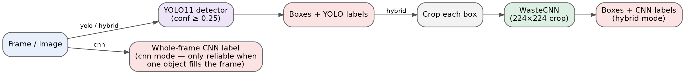

# Model Architectures

This document explains the two models in this project, how they are trained, and how they are used
at inference time.

| | **WasteCNN** | **YOLO11** |
|---|---|---|
| Task | Image **classification** of one object crop | Object **detection**: boxes + class for every object |
| Input | 3 × 224 × 224 crop | 3 × 640 × 640 full image |
| Output | 6 class logits | N boxes × (x1, y1, x2, y2, confidence, class) |
| Initialisation | Random (trained from scratch) | COCO-pretrained, fine-tuned |
| Size | 423,046 parameters | YOLO11n: 2.60 M · YOLO11m: 20.03 M (fused) |
| Compute | ≈ 0.74 G MACs ≈ 1.5 GFLOPs per crop (computed below) | YOLO11n: 6.4 GFLOPs · YOLO11m: 67.8 GFLOPs |
| Code | `build_wastecnn()` in [`main.py`](../main.py) | `ultralytics.YOLO` |

Contents: [1. Pipeline](#1-end-to-end-pipeline) ·
[2. WasteCNN](#2-wastecnn-custom-cnn-from-scratch) ·
[3. YOLO11](#3-yolo11-detector) ·
[4. Inference modes](#4-inference-modes) ·
[5. Design comparison](#5-why-the-two-models-behave-differently)

---

## 1. End-to-end pipeline

<p align="center"></p>

The same Roboflow dataset feeds both branches. YOLO trains on the full images and their bounding-box
labels. For the CNN, every ground-truth box is cut out and saved into an `ImageFolder` layout
(`split/class/*.jpg`), turning the detection dataset into a balanced classification dataset of
4,836 / 1,380 / 690 crops (train / valid / test).

---

## 2. WasteCNN (custom CNN from scratch)

### 2.1 Layer diagram

<p align="center"></p>



### 2.2 Layer-by-layer table

All convolutions are 3 × 3, stride 1, padding 1, so they keep the spatial size; only the max-pool
layers halve it. Shapes are for one 224 × 224 input.

| # | Layer | Output shape | Parameters |
|---|---|---|---:|
| — | Input crop (RGB, ImageNet-normalised) | 3 × 224 × 224 | 0 |
| 0 | Conv2d 3 → 32 | 32 × 224 × 224 | 896 |
| 1 | BatchNorm2d(32) | 32 × 224 × 224 | 64 |
| 2–3 | ReLU · MaxPool 2×2 | 32 × 112 × 112 | 0 |
| 4 | Conv2d 32 → 64 | 64 × 112 × 112 | 18,496 |
| 5 | BatchNorm2d(64) | 64 × 112 × 112 | 128 |
| 6–7 | ReLU · MaxPool 2×2 | 64 × 56 × 56 | 0 |
| 8 | Conv2d 64 → 128 | 128 × 56 × 56 | 73,856 |
| 9 | BatchNorm2d(128) | 128 × 56 × 56 | 256 |
| 10–11 | ReLU · MaxPool 2×2 | 128 × 28 × 28 | 0 |
| 12 | Conv2d 128 → 256 | 256 × 28 × 28 | 295,168 |
| 13 | BatchNorm2d(256) | 256 × 28 × 28 | 512 |
| 14 | ReLU | 256 × 28 × 28 | 0 |
| 15 | AdaptiveAvgPool2d(1 × 1) | 256 × 1 × 1 | 0 |
| c0–c1 | Flatten · Dropout(p) | 256 | 0 |
| c2–c3 | Linear 256 → 128 · ReLU | 128 | 32,896 |
| c4 | Dropout(p) | 128 | 0 |
| c5 | Linear 128 → 6 | 6 | 774 |
| | **Total trainable** | | **423,046** |

The total matches the count printed in the notebook. Indices match the `features.N` / `classifier.N`
keys in the saved `state_dict`, which is why checkpoints from the notebook load into `main.py` unchanged.

**Compute estimate.** Multiply–accumulates for the four conv layers are
224²·32·27 + 112²·64·288 + 56²·128·576 + 28²·256·1152 ≈ 43 M + 231 M + 231 M + 231 M ≈ **0.74 G MACs**
(≈ 1.5 GFLOPs counting multiply and add separately); the dense head adds < 0.1 M.

### 2.3 Design choices

- **Conv → BatchNorm → ReLU blocks.** BatchNorm stabilises training from random initialisation and lets a
  1e-3 learning rate work without warm-up.
- **Doubling filters, halving resolution.** 32 → 64 → 128 → 256 channels capture progressively more
  abstract features (edges → textures → parts such as caps, folds and labels).
- **Global average pooling instead of flattening a big feature map.** It reduces 256 × 28 × 28 to a
  256-vector with zero parameters, which keeps the head tiny (33.7 k params) and limits over-fitting on
  ≈ 4.8 k training crops.
- **Dropout on both dense layers.** Rate *p* is a tuned hyperparameter (0.2–0.5).
- **Receptive field.** After the fourth conv the theoretical receptive field is 38 × 38 input pixels (about a sixth of the crop);
  global pooling then aggregates over the whole crop.

### 2.4 Pre-processing and augmentation

| Stage | Train | Validation / Test |
|---|---|---|
| Resize | 224 × 224 (aspect ratio not kept) | 224 × 224 |
| Random horizontal flip | p = 0.5 | — |
| Random rotation | ± 10° | — |
| Colour jitter | brightness 0.15, contrast 0.15, saturation 0.10 | — |
| Normalise | ImageNet mean / std | ImageNet mean / std |

### 2.5 Training procedure

<p align="center"></p>

- **Loss:** cross-entropy. **Optimiser:** AdamW (decoupled weight decay). **Batch:** 32.
- **Early stopping** on validation loss: the checkpoint is saved whenever validation loss improves; training
  stops after `patience` epochs without improvement (5 for the baseline, 8 for tuning) or at 50 epochs.
  The best weights are restored at the end.
- **Hyperparameter search** (three configurations):

| Config | Learning rate | Dropout | Weight decay | Best val loss | Best val acc | Best epoch |
|---|---|---|---|---:|---:|---:|
| Baseline | 1e-3 | 0.27 | 1e-3 | 0.823 | 0.698 | 8 of 13 |
| **1 (selected)** | **1e-3** | **0.2** | **1e-4** | **0.491** | **0.841** | **50 of 50** |
| 2 | 1e-3 | 0.5 | 1e-4 | 0.733 | 0.734 | 14 of 22 |
| 3 | 3e-4 | 0.4 | 1e-4 | 0.621 | 0.788 | 24 of 32 |

---

## 3. YOLO11 detector

YOLO11 is Ultralytics' 2024 single-stage, anchor-free detector. One forward pass predicts boxes and
classes at three scales. The project uses the **nano (n)** and **medium (m)** sizes, which share the
same graph and differ only in depth/width multipliers.

### 3.1 Architecture diagram

<p align="center"></p>

Blue dashed arrows are skip connections carrying backbone (or earlier neck) features into a `Concat`.



### 3.2 Building blocks

| Block | What it does |
|---|---|
| **Conv** | Conv2d → BatchNorm → SiLU. Stride-2 Convs downsample (P1 … P5 = stride 2 … 32). |
| **C3k2** | YOLO11's CSP block: splits channels, passes one part through a stack of small bottlenecks (or `C3k` sub-blocks with 3 × 3 kernels in larger models), then concatenates. Cheap gradient paths with rich features. |
| **SPPF** | Spatial Pyramid Pooling – Fast: three chained 5 × 5 max-pools whose outputs are concatenated, enlarging the receptive field to see whole objects and context. |
| **C2PSA** | New in YOLO11: a CSP block with **position-sensitive multi-head self-attention** on the lowest-resolution map, so the model can weigh distant regions (e.g. a bottle cap and its label). |
| **FPN + PAN neck** | Top-down path brings semantic information to high-resolution maps; bottom-up path returns precise localisation to low-resolution maps. Outputs at strides 8, 16, 32 cover small, medium and large objects. |
| **Detect head** | Anchor-free and decoupled: separate conv branches for box regression and classification at each scale. Boxes are predicted as distances to the four sides, each as a 16-bin distribution (**Distribution Focal Loss**). |

### 3.3 Model sizes used

| | YOLO11n | YOLO11m |
|---|---|---|
| Depth / width multiplier | 0.50 / 0.25 | 0.50 / 1.00 |
| Max channels | 1024 (→ 256 effective) | 512 |
| Layers (fused) | 101 | 125 |
| Parameters (fused, 6 classes) | 2,598,266 | 20,034,658 |
| GFLOPs @ 640 | 6.4 | 67.8 |
| Inference (RTX 5060 Laptop) | 1.5–2.9 ms / image | 7.3 ms / image |
| Used for | Tuning runs → **final model** | Baseline |

Layer, parameter, GFLOP and speed figures are from the Ultralytics training logs in the notebook.

### 3.4 Loss function

Ultralytics' weighted sum, with the default gains shown in the training log:

$$\mathcal{L} = 7.5\,\mathcal{L}_{\text{CIoU}} + 0.5\,\mathcal{L}_{\text{BCE-cls}} + 1.5\,\mathcal{L}_{\text{DFL}}$$

- **CIoU** penalises box overlap error, centre distance and aspect-ratio mismatch.
- **BCE** classification over the 6 classes (independent sigmoid per class).
- **DFL** sharpens the 16-bin distribution of each box side around the true edge.

Positive samples are assigned by the **Task-Aligned Assigner**, which ranks anchor points by a mix of
classification score and IoU, so the same points are good for both tasks.

### 3.5 Training configuration

| Setting | Baseline | Tuning runs |
|---|---|---|
| Model | `yolo11m.pt` | `yolo11n.pt` |
| Epochs / early-stop patience | 40 / 8 | 25 / 5 |
| Image size / batch | 640 / 16 | 640 / 16 |
| Optimiser | AdamW, lr0 1e-3, wd 1e-4 | AdamW, grid over lr0 and wd |
| Augmentation (Ultralytics defaults) | mosaic 1.0 (off for last 10 epochs), HSV jitter, flip LR 0.5, translate 0.1, scale 0.5, random erasing 0.4 | same |
| Mixed precision | AMP on | AMP on |
| Selection metric | — | best validation mAP@50-95 |

| Tuning config | lr0 | Weight decay | Best val mAP@50-95 |
|---|---|---|---:|
| 1 | 1e-3 | 5e-4 | 0.811 |
| **2 (selected)** | **3e-4** | **5e-4** | **0.831** |
| 3 | 1e-3 | 1e-3 | 0.807 |

---

## 4. Inference modes

<p align="center"></p>

| `--mode` | Pipeline | When to use |
|---|---|---|
| `yolo` (default) | YOLO boxes + YOLO labels | Best accuracy; any number of objects |
| `cnn` | CNN on the whole frame → one label | One object filling the camera view (matches how the CNN was trained) |
| `hybrid` | YOLO boxes → crop → CNN label per box | Demonstrates the CNN inside a real detection pipeline |

```bash
python main.py webcam --mode hybrid
python main.py predict --source data/waste_dataset/test/images --mode yolo
```

---

## 5. Why the two models behave differently

| Factor | WasteCNN | YOLO11 |
|---|---|---|
| Prior knowledge | None — learns edges and textures from 4.8 k crops | Pretrained on COCO's 118 k images, then fine-tuned |
| Context | Sees only the cropped object | Sees the whole scene through SPPF, attention and multi-scale features |
| Capacity | 0.42 M parameters | 2.6–20 M parameters |
| Regularisation | Dropout, weight decay, light augmentation | Mosaic, scale/translate, HSV, random erasing, weight decay |
| Output | One label per crop | Variable number of boxes, labels and scores |

The CNN is a useful from-scratch baseline that shows what a small network learns without prior
knowledge; YOLO shows how far transfer learning and a detection-specific architecture go on the same data.
