# Results

Every number on this page was read from the outputs of the executed notebook
[`notebooks/waste_detection.ipynb`](../notebooks/waste_detection.ipynb). Training logs were parsed into
CSV files so they can be re-plotted or checked:

| File | Contents |
|---|---|
| [`metrics/metrics_summary.json`](../results/metrics/metrics_summary.json) | One-file summary of dataset, CNN and YOLO results |
| [`metrics/cnn_training_history.csv`](../results/metrics/cnn_training_history.csv) | Per-epoch loss / accuracy for the baseline and 3 tuning runs |
| [`metrics/cnn_hyperparameter_tuning.csv`](../results/metrics/cnn_hyperparameter_tuning.csv) | CNN tuning summary |
| [`metrics/cnn_test_classification_report.csv`](../results/metrics/cnn_test_classification_report.csv) | Per-class P / R / F1 for baseline and tuned CNN |
| [`metrics/yolo_training_history.csv`](../results/metrics/yolo_training_history.csv) | Per-epoch losses and val P / R / mAP for all 4 YOLO runs |
| [`metrics/yolo_hyperparameter_tuning.csv`](../results/metrics/yolo_hyperparameter_tuning.csv) | YOLO tuning summary |
| [`metrics/yolo_validation_summary.csv`](../results/metrics/yolo_validation_summary.csv) | Final validation of each run's `best.pt` |
| [`metrics/yolo_test_per_class.csv`](../results/metrics/yolo_test_per_class.csv) | Final model on the test split, per class |
| [`metrics/cnn_vs_yolo_test_comparison.csv`](../results/metrics/cnn_vs_yolo_test_comparison.csv) | Corrected comparison (both on test) |
| [`metrics/cnn_vs_yolo_metrics_notebook_original.csv`](../results/metrics/cnn_vs_yolo_metrics_notebook_original.csv) | The comparison exactly as the notebook produced it |

**Environment:** NVIDIA GeForce RTX 5060 Laptop GPU (8 GB) · Python 3.11.3 · PyTorch 2.11.0+cu128 ·
Ultralytics 8.4.190 · seed 42.

---

## 1. Dataset

| Split | Images | Objects | Objects per class |
|---|---:|---:|---:|
| Train | 3,337 | 4,836 | 806 |
| Valid | 959 | 1,380 | 230 |
| Test | 477 | 690 | 115 |

Classes: `Garbage_Bag`, `Glass`, `Paper_Bag`, `Pet_Bottle`, `Plastic_Bag`, `can`. The object counts are
perfectly balanced across classes, so accuracy and macro-averaged scores are directly comparable.

  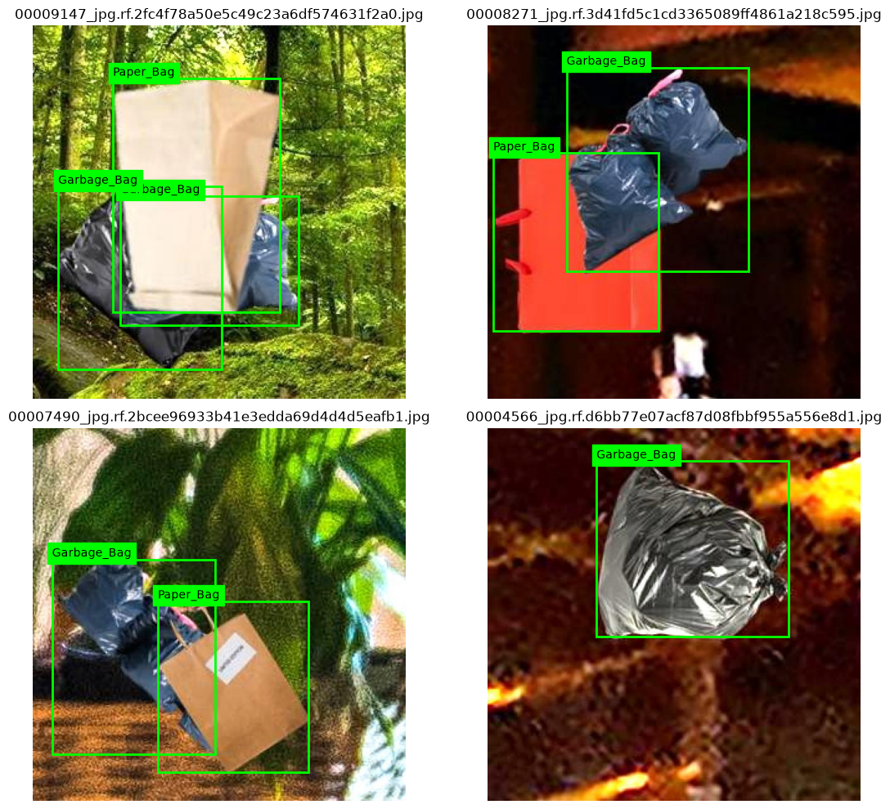
  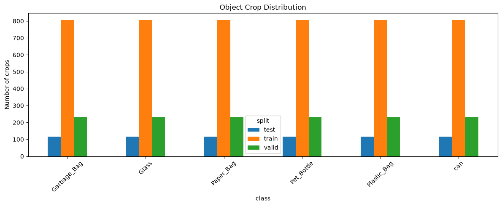

---

## 2. WasteCNN (classification of ground-truth crops)

### 2.1 Baseline run

lr 1e-3 · dropout 0.27 · weight decay 1e-3 · patience 5. Best validation loss 0.823 at epoch 8; early
stopping at epoch 13.

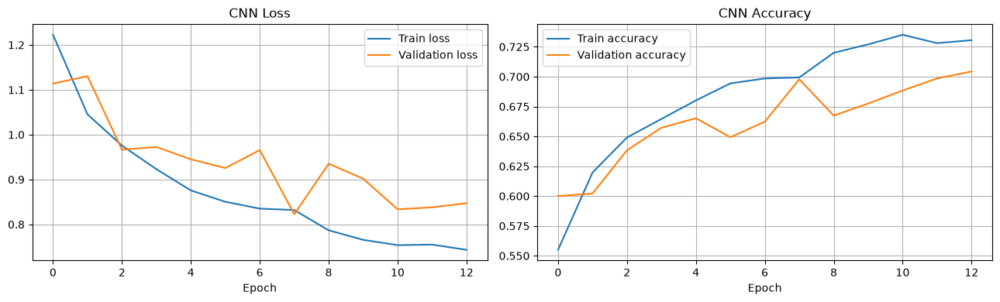

**Test set (690 crops): accuracy 0.7246** — weighted precision 0.7324, recall 0.7246, F1 0.7241.

| Class | Precision | Recall | F1 |
|---|---:|---:|---:|
| Garbage_Bag | 0.85 | 0.81 | 0.83 |
| Glass | 0.61 | 0.76 | 0.68 |
| Paper_Bag | 0.72 | 0.72 | 0.72 |
| Pet_Bottle | 0.73 | 0.81 | 0.77 |
| Plastic_Bag | 0.70 | 0.68 | 0.69 |
| can | 0.79 | 0.57 | 0.66 |

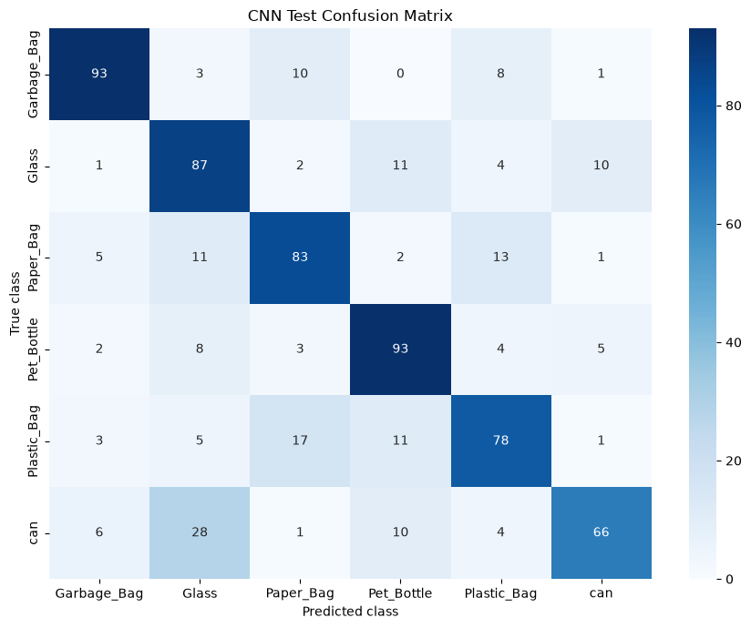

### 2.2 Hyperparameter tuning

| Config | lr | Dropout | Weight decay | Epochs run | Best epoch | Best val loss | Best val acc |
|---|---|---|---|---:|---:|---:|---:|
| **1** | **1e-3** | **0.2** | **1e-4** | **50** | **50** | **0.4909** | **0.8406** |
| 3 | 3e-4 | 0.4 | 1e-4 | 32 | 24 | 0.6209 | 0.7877 |
| 2 | 1e-3 | 0.5 | 1e-4 | 22 | 14 | 0.7329 | 0.7341 |

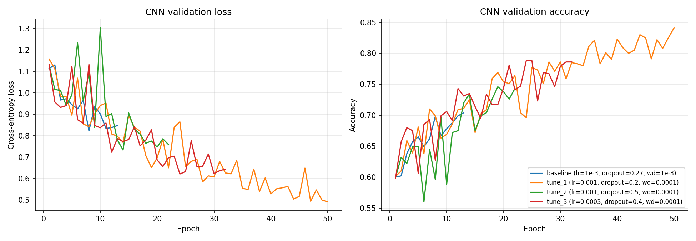

Config 1 reached its lowest validation loss on the **last** allowed epoch (50), so it had not converged —
a longer run or a learning-rate schedule is the most obvious next improvement. Heavy dropout (0.5)
slowed learning the most.

### 2.3 Tuned CNN on the test set

**Test accuracy 0.8188** (+9.4 points over the baseline). Macro and weighted P / R / F1 all 0.82.

| Class | Precision | Recall | F1 | Change in F1 vs baseline |
|---|---:|---:|---:|---:|
| Garbage_Bag | 0.87 | 0.85 | 0.86 | +0.03 |
| Glass | 0.88 | 0.78 | 0.83 | +0.15 |
| Paper_Bag | 0.74 | 0.90 | 0.82 | +0.10 |
| Pet_Bottle | 0.79 | 0.87 | 0.83 | +0.06 |
| Plastic_Bag | 0.84 | 0.67 | 0.74 | +0.05 |
| can | 0.83 | 0.83 | 0.83 | +0.17 |

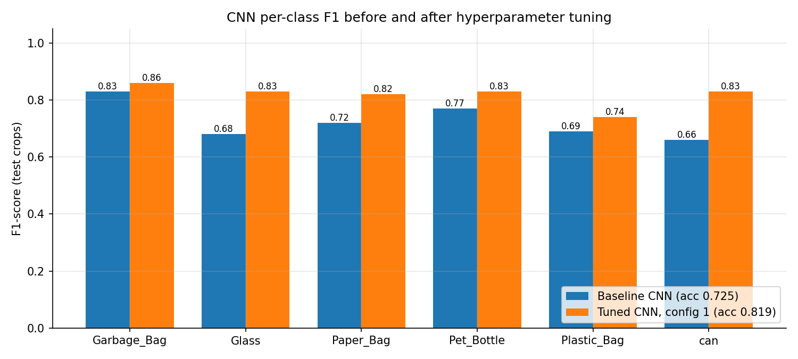

`Plastic_Bag` remains the weakest class (recall 0.67). In the baseline confusion matrix above, plastic
bags were most often predicted as `Paper_Bag` (17 of 115) or `Pet_Bottle` (11), and the largest single
error was `can` → `Glass` (28 of 115): shiny, cylindrical metal and glass look alike in small crops.
Cans and glass are also the two classes that gained the most from tuning (F1 +0.17 and +0.15).

> The notebook drew a confusion matrix only for the baseline CNN. Run
> `python main.py eval-cnn --checkpoint models/cnn_tuning_1.pt` to produce one for the tuned model.

---

## 3. YOLO11 (detection on full images)

### 3.1 Baseline — YOLO11m, 40 epochs

lr0 1e-3 · weight decay 1e-4 · AdamW · 3.18 h training. All 40 epochs ran (no early stop).
Final validation of `best.pt` (959 images, 1,380 objects):

| Class | Precision | Recall | mAP@50 | mAP@50-95 |
|---|---:|---:|---:|---:|
| **all** | **0.941** | **0.881** | **0.949** | **0.815** |
| Garbage_Bag | 0.895 | 0.822 | 0.919 | 0.762 |
| Glass | 0.939 | 0.900 | 0.948 | 0.842 |
| Paper_Bag | 0.951 | 0.878 | 0.940 | 0.841 |
| Pet_Bottle | 0.982 | 0.929 | 0.987 | 0.855 |
| Plastic_Bag | 0.963 | 0.861 | 0.941 | 0.832 |
| can | 0.916 | 0.896 | 0.959 | 0.759 |

  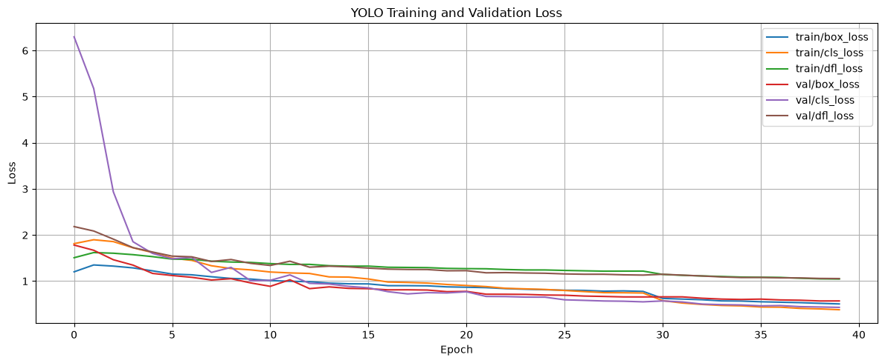

### 3.2 Hyperparameter tuning — YOLO11n, 25 epochs each

| Config | lr0 | Weight decay | Training time | Val P | Val R | Val mAP@50 | Val mAP@50-95 |
|---|---|---|---:|---:|---:|---:|---:|
| 1 | 1e-3 | 5e-4 | 0.49 h | 0.937 | 0.897 | 0.948 | 0.811 |
| **2** | **3e-4** | **5e-4** | **0.56 h** | **0.946** | **0.914** | **0.958** | **0.831** |
| 3 | 1e-3 | 1e-3 | 0.60 h | 0.937 | 0.903 | 0.948 | 0.807 |

All three runs peaked at epoch 25 — mAP was still rising, so longer training would probably help.

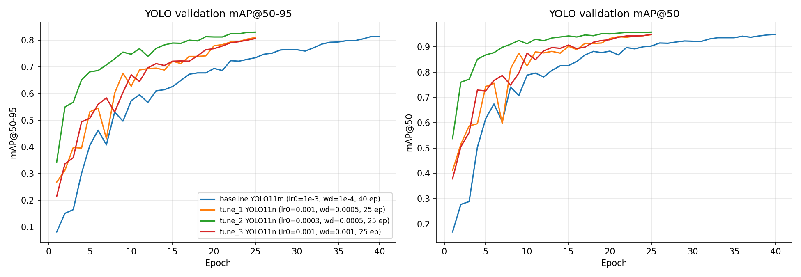

Ultralytics' own `results.png` for each run:
[baseline](../results/figures/yolo_results_baseline_yolo11m.png) ·
[tuning 1](../results/figures/yolo_results_tuning_1.png) ·
[tuning 2](../results/figures/yolo_results_tuning_2.png) ·
[tuning 3](../results/figures/yolo_results_tuning_3.png)

### 3.3 Final model on the test split

Selected checkpoint: `yolo_runs/tuning_2/weights/best.pt` (YOLO11n). 477 images, 690 objects.
Speed: 0.3 ms pre-process + 2.9 ms inference + 1.0 ms post-process per image.

| Class | Images | Precision | Recall | mAP@50 | mAP@50-95 |
|---|---:|---:|---:|---:|---:|
| **all** | 477 | **0.948** | **0.913** | **0.964** | **0.825** |
| Garbage_Bag | 87 | 0.927 | 0.861 | 0.931 | 0.784 |
| Glass | 110 | 0.965 | 0.952 | 0.991 | 0.874 |
| Paper_Bag | 96 | 0.943 | 0.870 | 0.947 | 0.788 |
| Pet_Bottle | 107 | 0.960 | 0.939 | 0.965 | 0.834 |
| Plastic_Bag | 89 | 0.928 | 0.887 | 0.963 | 0.851 |
| can | 83 | 0.965 | 0.966 | 0.988 | 0.818 |

F1 (from mean P and R) = **0.930**.

  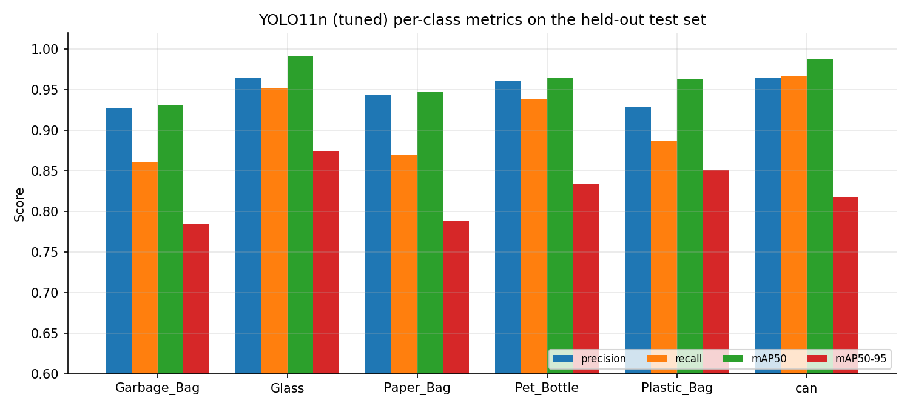

  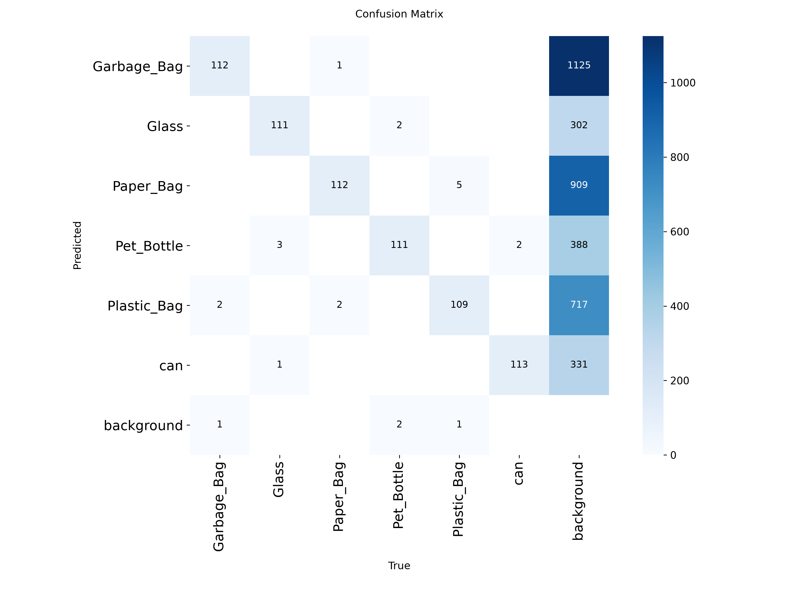

Sample predictions (confidence ≥ 0.25):

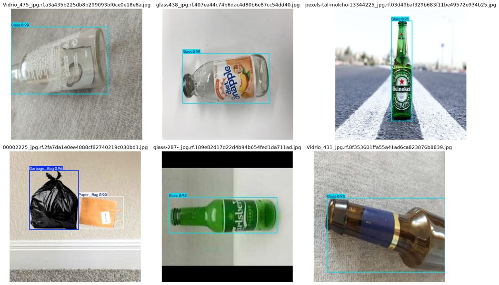

---

## 4. CNN vs YOLO

### 4.1 Corrected comparison (both on the test split)

| Metric | WasteCNN (tuned) | YOLO11n (tuned) |
|---|---:|---:|
| Precision | 0.82 | 0.948 |
| Recall | 0.82 | 0.913 |
| F1-score | 0.82 | 0.930 |
| mAP@50 | — | 0.964 |
| mAP@50-95 | — | 0.825 |
| Parameters | 0.42 M | 2.60 M |

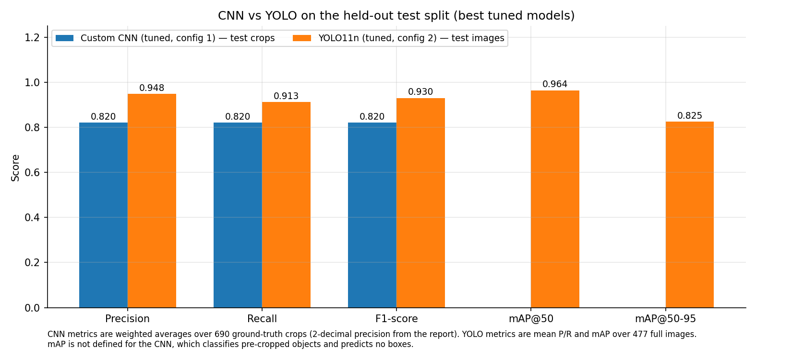

### 4.2 Note on the comparison chart inside the notebook

The notebook's last comparison cell (saved here as
[`cnn_vs_yolo_notebook_original.png`](../results/figures/cnn_vs_yolo_notebook_original.png)) reports
CNN 0.732 / 0.725 / 0.724 and YOLO 0.946 / 0.914 / 0.930 / 0.958 / 0.831. Two things make it
less representative than the table above:

1. **Wrong CNN checkpoint.** Its auto-selection picked `models/cnn_best.pt`, which is the *baseline*
   CNN (72.5 % accuracy), not the tuned `cnn_tuning_1.pt` (81.9 %).
2. **Different splits.** The YOLO numbers came from the last *validation* epoch of `tuning_2`, while
   the CNN numbers were on the *test* split.

`main.py compare` fixes both: it uses the tuned checkpoint and evaluates both models on the test split.

### 4.3 Interpretation

- YOLO wins on every shared metric even though its task is harder (it must also localise objects).
  Pretraining on COCO and a much richer augmentation pipeline are the main reasons.
- The CNN's job is easier but it learns everything from ≈ 4.8 k crops, and it is not given scene context.
- Both models find deformable bags hardest: `Plastic_Bag` for the CNN, `Garbage_Bag` / `Paper_Bag` for YOLO
  at the strict mAP@50-95 threshold. YOLO is near-perfect on rigid objects (glass, cans, PET bottles at mAP@50).

---

## 5. Reproducibility notes

- Seed 42 for Python, NumPy and PyTorch; `deterministic=True` for YOLO. GPU kernels can still give
  small run-to-run differences.
- The YOLO11m baseline and the YOLO11n tuning runs differ in model size, epochs, patience *and* weight
  decay, so the "nano beats medium" result is an observation, not a controlled comparison.
- Ultralytics warned that one label file contained a segmentation polygon among 4,836 boxes; it was
  converted to a box automatically and does not affect results.
